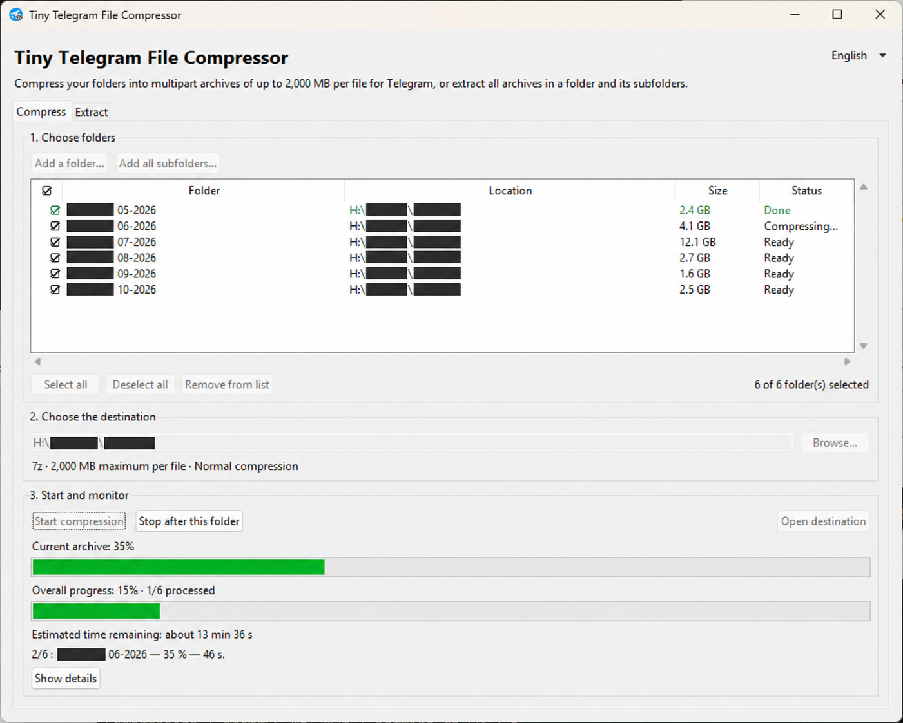
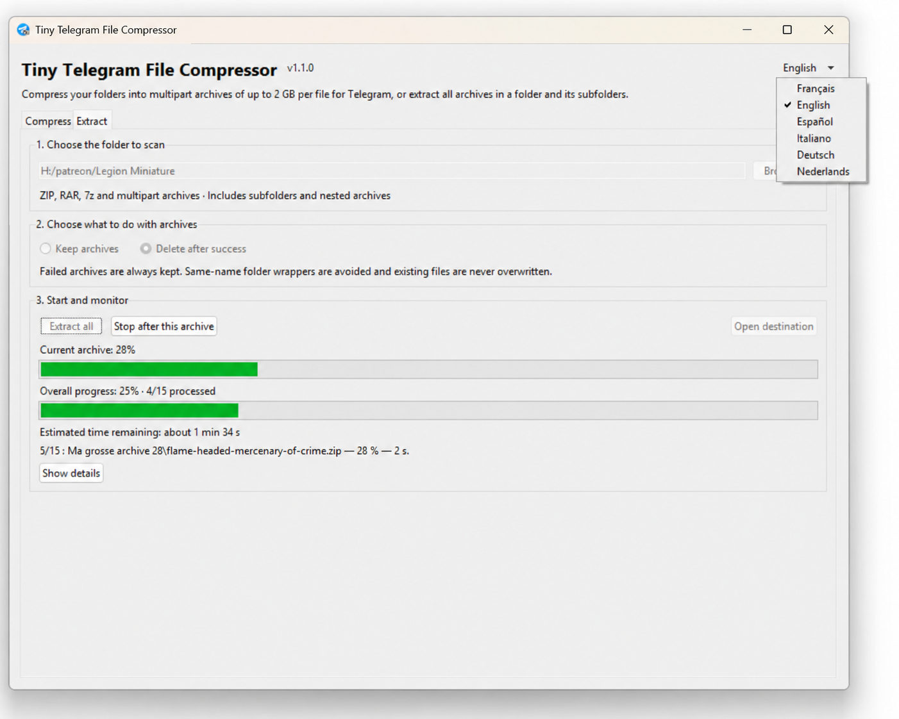
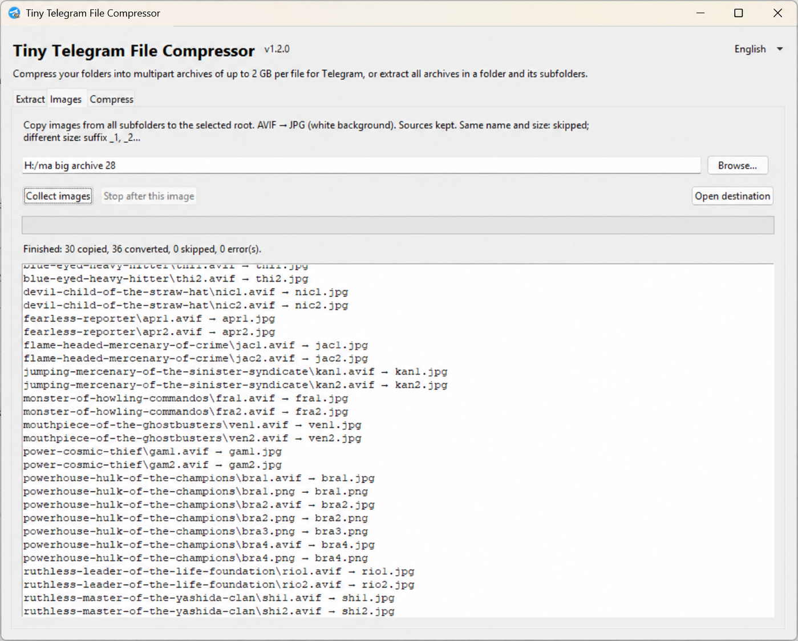

# Tiny Telegram File Compressor

**Compress folders into separate multipart 7z archives, with a 2000 MiB limit per part, or extract archives recursively.**

A Windows desktop utility for preparing files to share on Telegram. Choose folders from different drives, follow progress and estimated remaining time, and extract ZIP, RAR and 7z collections from a single interface.

Interface languages: **English, Français, Español, Italiano, Deutsch, Nederlands, Русский, हिन्दी, 简体中文** (Simplified Chinese).

## Downloads

Get the executable and source code from [GitHub Releases](https://github.com/goliom/tiny-telegram-file-compressor/releases/latest).

Windows releases are currently unsigned. Our application to the **SignPath Foundation** open-source signing program was submitted on October 23, 2026 and is awaiting review; acceptance and signing are not yet in place. See our [Code signing policy](CODE_SIGNING.md) and [Privacy policy](PRIVACY.md).

## Preview

**Folder compression**



**Archive extraction and language selection**



**Image collection and AVIF conversion**



## Features

- **Images** tab: recursively copy images from subfolders into the chosen root, preserve originals and convert AVIF and WebP to JPG.
- Matching output names and sizes are skipped; different sizes receive `_1`, `_2`, etc. Conversion uses JPG quality 95 and a white background for transparency. Animated AVIF and WebP use their first frame. Size matching does not compare image contents.

- One independent 7z archive set per selected folder, including all its contents and subfolders.
- Parts limited to **2000 MiB (2,097,152,000 bytes)** each: binary MiB (1 MiB = 1,048,576 bytes). Compression is fixed to **Normal**.

  Telegram Desktop displays a full part as **2,000 MB**. This fixed limit follows the [documented free-account configuration](https://core.telegram.org/api/config#upload_max_fileparts_default); Telegram supplies its actual limits to clients at runtime.
- A single volume smaller than 2000 MiB is saved as `.7z`; multipart archives use `.7z.001`, `.7z.002`, etc.
- Add folders from different drives or add all direct subfolders of a parent folder.
- Checkbox list with folder names, locations, sizes and processing status.
- Separate **Compress** and **Extract** tabs, each organized into three steps.
- Recursive ZIP, RAR and 7z extraction, including supported multipart archives and archives found inside extracted folders.
- Avoids redundant same-name folder wrappers, such as `Model/Model/parts` becoming `Model/parts`, while preserving other layouts.
- Choose **Keep archives** or **Delete after success**. Keeping archives is the GUI default.
- Live item progress, size-weighted overall progress, approximate remaining time and an expandable log.
- Stop after the current folder/archive, plus an **Open destination** button after processing.
- Compression keeps the source folders. Existing output archives and files are protected against overwriting.

The program prepares files locally. Send the resulting parts through your Telegram app when they are ready.

## Requirements

- **Windows x64** with a desktop session for the executable.
- **7-Zip**, installed separately from [7-zip.org](https://www.7-zip.org/). The app checks `PATH` and the standard Windows installation folders.
- **For running from source only:** Python 3.12 or newer, including Tkinter/Tcl/Tk. Use the Windows installer from [python.org](https://www.python.org/downloads/windows/) and include the Tcl/Tk component.

The Windows executable includes Python, Tk and Pillow with AVIF support; users do not need a Python installation. Source users must install `requirements.txt`. 7-Zip is an external program and is not bundled.

## Getting started

### Windows executable

1. Open [Releases](https://github.com/goliom/tiny-telegram-file-compressor/releases) and download `TinyTelegramFileCompressor-v1.2.1-windows-x64.zip`.
2. Extract the ZIP and install 7-Zip if needed.
3. Run `TinyTelegramFileCompressor.exe`.
4. Select a language from the top-right menu. The initial interface is French.

The executable is unsigned. The ZIP includes quick-start instructions and runtime license notices.

### Run from source

1. Download this repository using **Code → Download ZIP**, then extract the downloaded ZIP completely.
   Install image support with `py -3 -m pip install -r requirements.txt`.
2. Install Python and 7-Zip if needed.
3. Double-click **`Tiny Telegram File Compressor.bat`** inside the extracted folder.
4. Use the language menu at the top to select English or another language. The initial interface is French.

You can also start the app from PowerShell:

```powershell
py -3 compresser_dossiers.py
```

Keep the Python files and the `assets` folder together. A detailed French guide is included in [COMPRESSER_DOSSIERS-LISEZ-MOI.txt](COMPRESSER_DOSSIERS-LISEZ-MOI.txt).

## Compress folders

1. In **Compress**, click **Add a folder…** or **Add all subfolders…**. The second button adds the chosen folder's immediate child folders. Repeat from other locations if needed.
2. Check the folders to process. **Remove from list** only removes highlighted rows from the interface; it does not delete folders from disk.
3. Choose a shared destination outside all selected source folders, then click **Start compression**.

Each source gets its own archive set. Selecting `Collection A` and `Collection B` can produce:

```text
Collection A.7z.001
Collection A.7z.002
Collection B.7z
```

A single volume smaller than 2000 MiB uses the `.7z` extension and opens directly with 7-Zip. Larger archives are split into numbered parts; the last part is smaller when necessary. Keep all parts together and open `.7z.001` with 7-Zip to extract the set. A single volume exactly 2000 MiB keeps its numbered name.

The source folder itself is included in its archive. Two selected folders with the same name must be renamed or processed separately into different destinations.

## Extract archives

1. Open **Extract** and choose the root folder to scan.
2. Choose **Keep archives** or **Delete after success**.
3. Click **Extract all**.

The scan includes all subfolders and archives discovered inside newly extracted content. Supported naming patterns include:

```text
model.zip / model.rar / model.7z
model.7z.001 + model.7z.002 + ...
model.zip.001 + model.zip.002 + ...
model.part1.rar + model.part2.rar + ...
model.rar + model.r00 + model.r01 + ...
model.zip + model.z01 + model.z02 + ...
```

All volumes must be present and supported by the installed 7-Zip. Bare `.001` files without a `.7z` or `.zip` extension and formats such as TAR/GZ are not scanned.

An archive is normally extracted into a neighboring folder with its name. Sole, identically named folder wrappers are removed. If `Model.zip` is already inside a folder named `Model`, its extracted content can be added directly to that folder. Different folder names and layouts with sibling content are preserved.

Existing content is not overwritten. A conflict, missing volume, corrupt archive or password-protected archive is reported, and the remaining source archive files are kept. Processing continues with other archives.

### Keeping archives and resuming cleanup

The extraction root contains a `.decompression-tout.json` journal. Leave it in place to recognize completed extractions on subsequent runs.

- With **Keep archives**, already extracted, unchanged archives are recognized without extracting them again.
- A later run with **Delete after success** can delete those archives without a second extraction, after checking that their recorded size and modification time are unchanged and the output directory still exists.
- This journal is a resume record, not a complete integrity audit of previously extracted files.

Interrupted work may remain in `*.compression-en-cours` or `*.extraction-en-cours` folders. Inspect and move those temporary folders before retrying the same item. The program does not automatically overwrite or erase interrupted output.

## Progress and stopping

The interface displays the current item, overall progress, processed-item counts and estimated remaining time. Size discovery uses file metadata in a background thread.

Remaining time is approximate and becomes available after initial progress measurements. It may change with disk speed, file contents and newly discovered nested archives. When sizes are not known, overall progress falls back to item progress.

**Show details** expands the log. Errors remain visible in the final summary even when details are collapsed. **Stop after this folder/archive**, or closing the app, lets the current item finish before stopping the rest.

One job runs at a time. All three tabs remain viewable during a job; other tabs' processing controls are disabled until it finishes. Language switching stays available.

## Optional command-line usage

Preview compression without creating archives:

```powershell
py -3 compresser_dossiers.py "D:\Example\Collection A" "E:\Example\Collection B" --destination "D:\Example\Archives" --apercu
```

Remove `--apercu` to perform compression.

Preview extraction:

```powershell
py -3 decompresser_tout.py "D:\Example\Downloads" --apercu
```

Extract while keeping archives, without an interactive confirmation:

```powershell
py -3 decompresser_tout.py "D:\Example\Downloads" --garder-archives --appliquer
```

**The standalone extraction CLI deletes successfully extracted archives by default.** Add `--garder-archives` to keep them. The GUI also defaults to deleting successfully extracted archives; select **Keep archives** before starting to preserve them.

## Development and tests

Run the test suite on Windows with Python, Tkinter and 7-Zip installed:

```powershell
py -3 -m unittest discover -s tests -p "test_*.py"
```

GUI tests create temporary Tk windows and require a desktop session. Tests use temporary sample folders under the repository and clean them up afterwards.

The included test workflow runs Windows tests with Python 3.12 and 3.14.
The separate **Build Windows release** workflow can be started manually to produce and verify the executable.
See [BUILDING.md](BUILDING.md) for local builds and release assets.

## Notes

- The application currently targets Windows; other platforms are not supported by the launcher, folder-opening code or extraction lock.
- The GUI is translated into nine languages. Some console output and detailed backend errors remain French; Windows dialogs and 7-Zip may use their own language.
- The icon is an AI-generated combination of a Telegram-style paper airplane and a `7z` badge. This is an independent tool, not an official Telegram or 7-Zip product. See [assets/README.txt](assets/README.txt).

## License

This project's code is distributed under the [MIT License](LICENSE).
External programs and third-party names retain their own terms; see [THIRD_PARTY_NOTICES.md](THIRD_PARTY_NOTICES.md).
